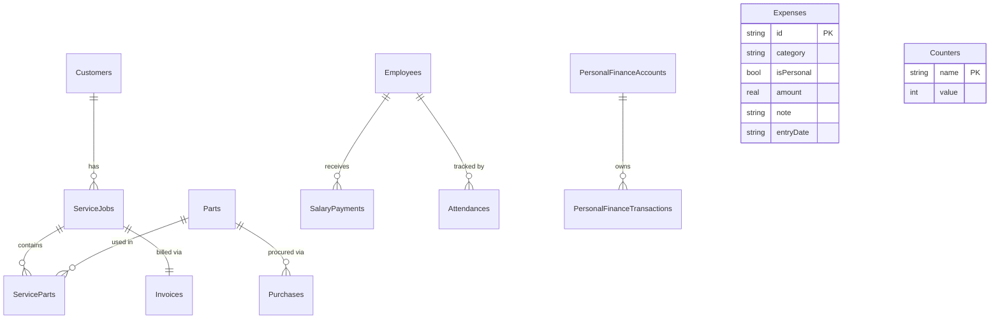
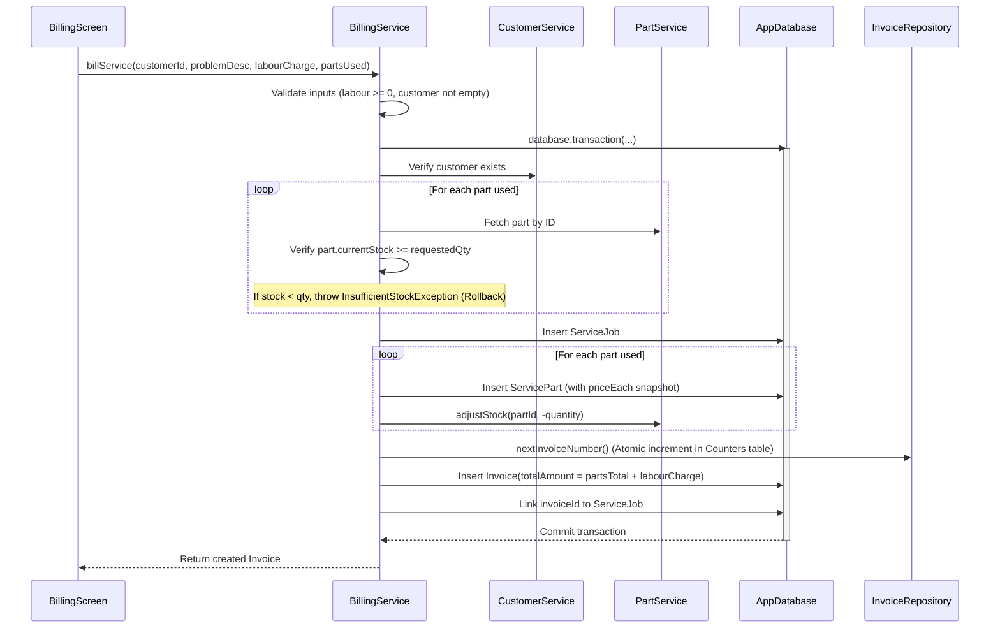
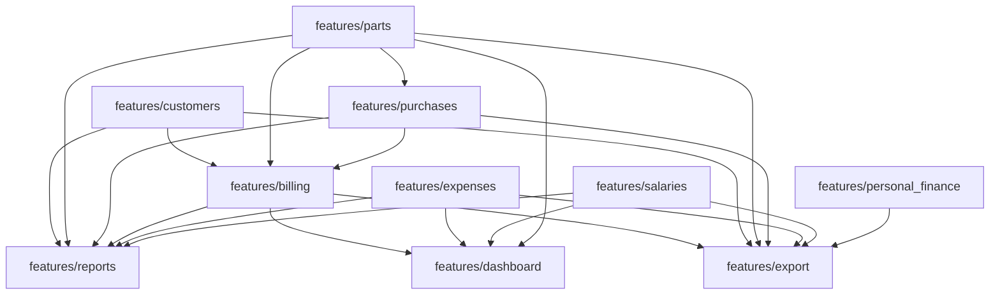

# System Architecture & Technical Reference

> **Repository:** `JournalKenobi11/inventory_management_system`  
> **Target Audience:** Developers, Maintainers, and Autonomous AI Agents modifying this codebase.  
> **Source of Truth:** Describes the **actual implemented production code**, not an abstract design document.

---

## 1. Project Overview

### What the Application Is
The **Garage & Inventory Management System** is a standalone, local-first Flutter application tailored for motorcycle and automotive repair garages, workshops, and parts retail shops. It provides an all-in-one operational platform covering:
- **Customer CRM & Service History:** Vehicle details, customer contact information, and lifetime service history.
- **Inventory & Stock Management:** Part catalogs, stock tracking, low-stock threshold alerting, and purchase stock-in logs.
- **Billing & Job Card Invoicing:** Point-of-sale job-card billing, atomic stock deduction, labour charging, price snapshotting, and sequential invoice numbering.
- **Business Operational Expenses:** Categorized tracking of garage operating expenses (rent, tools, electricity, supplies).
- **Staff, Salaries & Attendance:** Employee management, monthly salary tracking, payment status (`paid` vs `pending`), and punctuality scoring.
- **Owner's Personal Finance:** A dedicated manual ledger for the owner's personal money (credits/debits, running balance, opening balance) completely decoupled from garage business accounts.
- **Executive Dashboard & Analytical Reporting:** Real-time metrics on gross sales, net profit, inventory valuation, category breakdowns, and exportable PDF summaries.
- **Backup & Disaster Recovery:** Complete JSON and SQLite database export/import with strict schema versioning and WhatsApp/system sharing.

### Local-First & Offline Architecture
The application runs **100% offline and locally**. There are no cloud endpoints, remote databases, or external telemetry requirements. All data is persisted directly onto the device using SQLite via **Drift** (a type-safe reactive persistence framework for Dart/Flutter).

### Core Technology Stack
- **UI Framework:** Flutter (Targeting Android, iOS, Windows, Desktop) with **Material 3 (M3)** design system.
- **State Management:** **Riverpod** (`flutter_riverpod: ^3.3.2`) with `Provider`, `FutureProvider`, `NotifierProvider`, and `AsyncNotifierProvider`.
- **Database Engine:** SQLite through **Drift** (`drift: ^2.34.2`, `sqlite3_flutter_libs: ^0.6.0+eol`, `drift_dev: ^2.34.0`).
- **File System & Paths:** `path_provider: ^2.1.6`, `path: ^1.9.1`.
- **Identifiers:** Version 4 UUIDs generated via `uuid: ^4.6.0`.
- **Reporting & Visualizations:** `fl_chart: ^1.2.0` for analytics; `pdf: ^3.13.1` for document generation.
- **Sharing & Interop:** `share_plus: ^13.3.1` for document dispatch; `url_launcher: ^6.3.3` for direct WhatsApp dispatch.

### Strict Architectural Layering
The codebase is structured around a strict one-directional layering pattern:

```text
       Flutter UI (Screens & Widgets)
                     │
                     ▼
                 Providers (Riverpod)
                     │
                     ▼
                 Services (Pure Business Logic)
                     │
                     ▼
           Repository Interfaces (Abstract Contracts)
                     │
                     ▼
          SQLite Repositories (Drift Query Layer)
                     │
                     ▼
              Drift (Data Mapper)
                     │
                     ▼
              SQLite Engine (Local Disk)
```

| Layer | Responsibility | What it May Call | What is Forbidden |
|---|---|---|---|
| **Screens / Widgets** | Renders UI, accepts user input, displays feedback dialogs. | Riverpod Providers | Direct calls to Services, Repositories, Drift, or SQLite. |
| **Providers** | Exposes view state, manages UI loading/error lifecycles, triggers Service operations. | Feature Services, Core Providers | Business calculations, stock arithmetic, money math, DB calls. |
| **Services** | Owns 100% of business logic: validation, price snapshots, stock math, transaction orchestration. | Repository Interfaces, Other Feature Services | Direct SQLite queries, UI widgets, Drift-generated query builders. |
| **Repository Interfaces** | Defines clean, asynchronous Dart contracts returning plain models (`Future<T>`). | Models | Implementation details, Drift types. |
| **SQLite Repositories** | Executes Drift queries, maps Drift table rows ↔ plain Dart models. | `AppDatabase`, Drift Tables | Business decisions, exposing Drift row classes upward. |
| **Drift / SQLite** | Schema definitions, migrations, disk I/O, relational constraints. | Native C SQLite | Raw unescaped strings without type safety. |

---

## 2. Complete Project Structure

The project code resides strictly under `lib/` and conforms to feature-driven modular design:

```text
lib/
├── core/
│   ├── di/
│   │   └── providers.dart               # Global core providers (appDatabaseProvider)
│   ├── errors/
│   │   └── app_exceptions.dart          # Typed business exceptions
│   ├── utils/
│   │   ├── date_utils.dart              # Standard ISO-8601 serialization helpers
│   │   ├── id_generator.dart            # UUID v4 generator
│   │   └── phone_number_utils.dart      # WhatsApp phone normalization
│   └── widgets/
│       └── app_drawer_button.dart       # Reusable top-left hamburger button (☰)
├── database/
│   ├── app_database.dart                # Drift database definition, tables, migrations
│   └── app_database.g.dart              # Generated Drift code (build_runner)
├── features/
│   ├── billing/                         # Module 4: Job-card billing, invoicing, line items
│   ├── customers/                       # Module 1: Customer profiles & billing history
│   ├── dashboard/                       # Module 7: Executive KPI summary
│   ├── expenses/                        # Module 5: Garage operational expense ledger
│   ├── export/                          # Module 9: Backup, restore, PDF generation, WhatsApp sharing
│   ├── parts/                           # Module 2: Spare parts catalog & stock levels
│   ├── personal_finance/                # Module 10: Owner's personal money ledger
│   ├── purchases/                       # Module 3: Supplier stock-in procurement
│   ├── reports/                         # Module 8: Financial statements & parts performance
│   └── salaries/                        # Module 6: Employees, salary payments & attendance
└── main.dart                            # Application entry point, App shell & NavigationDrawer
```

### Feature Breakdown

Each feature folder is self-contained with a single public export barrel file (e.g., `features/billing/billing.dart`). Outside code **only** imports this barrel file.

#### 1. `customers`
- **Purpose:** Customer contact details and vehicle registration.
- **Data Owned:** `Customers` table (`id`, `name`, `mobile`, `vehicleName`, `createdDate`).
- **Services:** `CustomerService` (CRUD, mobile validation, delete safeguards).
- **Interactions:** Consumed by `BillingService` (customer selection & billing history), `DashboardService`, and `ExportService`.

#### 2. `parts`
- **Purpose:** Inventory catalog, unit pricing, real-time stock balances, and low-stock reorder levels.
- **Data Owned:** `Parts` table (`id`, `partNumber`, `partName`, `category`, `purchasePrice`, `sellingPrice`, `currentStock`, `lowStockThreshold`).
- **Services:** `PartService` (CRUD, unique part number enforcement, stock adjustments).
- **Interactions:** Consumed by `Purchases` (stock-in), `Billing` (stock validation, snapshotting, stock-out), `Dashboard`, and `Reports`.

#### 3. `purchases`
- **Purpose:** Supplier stock-in purchase orders.
- **Data Owned:** `Purchases` table (`id`, `partId`, `quantity`, `purchasePrice`, `purchaseDate`).
- **Services:** `PurchaseService` (validates purchase price & quantity, records procurement, atomically increments part stock).
- **Interactions:** Calls `PartService.adjustStock(partId, quantity)`.

#### 4. `billing`
- **Purpose:** Garage service job cards, part usage, labour charges, invoice generation, and customer history.
- **Data Owned:** `ServiceJobs`, `ServiceParts`, `Invoices`, `Counters` (`invoice_number`).
- **Services:** `BillingService` (transaction orchestration, price snapshotting, stock verification, sequential numbering, history retrieval).
- **Interactions:** Directly coordinates with `CustomerService`, `PartService`, and `AppDatabase.transaction`.

#### 5. `expenses`
- **Purpose:** Garage operational expenses (shop rent, electricity, consumable tools, maintenance).
- **Data Owned:** `Expenses` table (`id`, `category`, `isPersonal`, `amount`, `note`, `entryDate`).
- **Services:** `ExpenseService` (validates amount > 0, non-empty category).
- **Interactions:** Read by `DashboardService` and `ReportService` (which filter on `!isPersonal` for business accounting).

#### 6. `salaries`
- **Purpose:** Garage employee management, salary disbursements, monthly dues, daily attendance, and punctuality scoring.
- **Data Owned:** `Employees`, `SalaryPayments`, `Attendances`.
- **Services:** `SalaryService` (monthly salary balances, records payments) and `AttendanceService` (records present/absent, checks 10:30 AM punctuality cutoff).
- **Interactions:** Read by `DashboardService` and `ReportService` for payroll expense reconciliation.

#### 7. `dashboard`
- **Purpose:** Executive overview providing high-level KPIs across custom date ranges.
- **Data Owned:** Read-only aggregator (owns no tables).
- **Services:** `DashboardService` (aggregates sales, expenses, net profit, services count, inventory value, pending payroll).
- **Interactions:** Calls `BillingService`, `ExpenseService`, `SalaryService`, `PartService`.

#### 8. `reports`
- **Purpose:** Deep financial and inventory analytics across Monthly, Quarterly, and Yearly intervals.
- **Data Owned:** Read-only analytical aggregator.
- **Services:** `ReportService` (revenue breakdown, COGS, gross/net margins, top-selling parts, expense category distributions).
- **Interactions:** Aggregates `Billing`, `Parts`, `Purchases`, `Expenses`, `Salaries`, and triggers `PdfService` for report exports.

#### 9. `export`
- **Purpose:** JSON and SQLite backup/restore, PDF invoice/report rendering, and WhatsApp customer sharing.
- **Data Owned:** No standalone tables; interfaces with all database tables.
- **Services:** `BackupService`, `PdfService`, `ShareService`.
- **Interactions:** Reads and restores all 13 Drift tables via `SqliteBackupRepository`.

#### 10. `personal_finance`
- **Purpose:** Separate personal ledger representing the owner's actual personal money (cash on hand / personal account).
- **Data Owned:** `PersonalFinanceAccounts`, `PersonalFinanceTransactions`.
- **Services:** `PersonalFinanceService` (maintains owner account, credit/debit validation, running balance, monthly summary).
- **Interactions:** Standalone ledger. Completely isolated from business revenue/expenses.

---

## 3. Architectural Rules & Invariants

The repository enforces strict architectural guardrails documented in [AGENTS.md](file:///c:/Users/aasha/OneDrive/Desktop/inventory_management_system/AGENTS.md) and mechanically verified via [scripts/check_architecture.sh](file:///c:/Users/aasha/OneDrive/Desktop/inventory_management_system/scripts/check_architecture.sh):

1. **One-Directional Layering:**
   - A layer may only call the layer directly below it. Screens never import anything from `database/` or `repositories/sqlite/`.
2. **Business Logic Exclusively in `services/`:**
   - Validation rules, money math, stock arithmetic, and atomic multi-step sequencing belong strictly in Service methods.
3. **Domain Models Are Plain Dart Objects:**
   - Repository interfaces return plain models from `models/` (with `copyWith`, value equality, `toJson`/`fromJson`), never Drift-generated row classes (`CustomerData`, `InvoiceData`, etc.).
4. **All Repository Methods Return `Future<T>`:**
   - Keeps interfaces asynchronous so future API/cloud adapters can act as drop-in replacements.
5. **No SQL/Drift Outside `repositories/sqlite/`:**
   - All query composition occurs within SQLite repositories.
6. **Typed Custom Exceptions:**
   - Raw SQLite/Drift exceptions (`SqliteException`) must never propagate upward. They are mapped to `core/errors/app_exceptions.dart` types (`NotFoundException`, `ValidationException`, `InsufficientStockException`).
7. **UUID Strings for Primary Keys:**
   - All record IDs are UUID v4 strings generated via `IdGenerator.generate()`. SQLite autoincrement integer IDs are never leaked into the domain model.
8. **One Feature = One Folder with a Barrel File:**
   - External code imports only `features/<name>/<name>.dart`. Reaching into internal subfolders is forbidden.
9. **Cross-Feature Communication via Services Only:**
   - Features interact through other features' public Services, never directly through repositories.
10. **Historical Prices Are Snapshotted at Transaction Time:**
    - Line item unit prices (`priceEach`) are frozen at billing time. Historical invoices must never change when a part's catalog price changes.
11. **Multi-Step Operations Run in Database Transactions:**
    - Multi-table writes (e.g., billing: stock deduction + service creation + invoice generation) execute within `database.transaction()`. Partial writes are unacceptable.

---

## 4. Database Architecture

The database is defined in [lib/database/app_database.dart](file:///c:/Users/aasha/OneDrive/Desktop/inventory_management_system/lib/database/app_database.dart). It uses SQLite via Drift native bindings.

- **Disk File Location:** `inventory_management.sqlite` in the application documents directory (via `getApplicationDocumentsDirectory()`).
- **Current Schema Version:** `3`.
- **Migration Strategy:** `MigrationStrategy` handling incremental upgrades from version 1 to 2 (adding `Attendances`) and version 2 to 3 (adding `PersonalFinanceAccounts` and `PersonalFinanceTransactions`).

### Complete Database Schema Reference

#### 1. `customers`
- **Purpose:** Stores customer master records and vehicle ownership.

| Column | Drift Type | Dart Type | Nullable | Default | Constraints | Description |
|---|---|---|---|---|---|---|
| `id` | Text | `String` | No | None | Primary Key | UUID v4 |
| `name` | Text | `String` | No | None | None | Customer full name |
| `mobile` | Text | `String` | No | None | None | Mobile phone number |
| `vehicle_name` | Text | `String?` | Yes | None | None | Vehicle model/make/reg |
| `created_date` | Text | `String` | No | None | None | ISO-8601 creation timestamp |

#### 2. `parts`
- **Purpose:** Master catalog of replacement parts, unit costs, stock counts, and reorder alerts.

| Column | Drift Type | Dart Type | Nullable | Default | Constraints | Description |
|---|---|---|---|---|---|---|
| `id` | Text | `String` | No | None | Primary Key | UUID v4 |
| `part_number` | Text | `String` | No | None | UNIQUE | Unique part SKU/number |
| `part_name` | Text | `String` | No | None | None | Descriptive part name |
| `category` | Text | `String?` | Yes | None | None | Part classification |
| `purchase_price`| Real | `double` | No | None | None | Cost price per unit (₹) |
| `selling_price` | Real | `double` | No | None | None | Retail selling price per unit (₹) |
| `current_stock` | Integer | `int` | No | `0` | None | On-hand quantity |
| `low_stock_threshold` | Integer | `int` | No | `5` | None | Alert threshold for low inventory |

#### 3. `purchases`
- **Purpose:** Procurement log of incoming inventory purchases from suppliers.

| Column | Drift Type | Dart Type | Nullable | Default | Constraints | Description |
|---|---|---|---|---|---|---|
| `id` | Text | `String` | No | None | Primary Key | UUID v4 |
| `part_id` | Text | `String` | No | None | FK -> `parts.id` | Foreign key referencing part |
| `quantity` | Integer | `int` | No | None | None | Quantity purchased |
| `purchase_price`| Real | `double` | No | None | None | Unit cost paid |
| `purchase_date` | Text | `String` | No | None | None | ISO-8601 purchase date |

#### 4. `service_jobs`
- **Purpose:** Job cards describing repair work requested by a customer.

| Column | Drift Type | Dart Type | Nullable | Default | Constraints | Description |
|---|---|---|---|---|---|---|
| `id` | Text | `String` | No | None | Primary Key | UUID v4 |
| `customer_id` | Text | `String` | No | None | FK -> `customers.id`| Customer receiving service |
| `problem_desc` | Text | `String?` | Yes | None | None | Reported issue description |
| `labour_charge` | Real | `double` | No | `0.0` | None | Service labour charge (₹) |
| `service_date` | Text | `String` | No | None | None | ISO-8601 job date |
| `invoice_id` | Text | `String?` | Yes | None | None | Linked invoice identifier |

#### 5. `service_parts`
- **Purpose:** Parts consumed in a service job card, with frozen price snapshots.

| Column | Drift Type | Dart Type | Nullable | Default | Constraints | Description |
|---|---|---|---|---|---|---|
| `id` | Text | `String` | No | None | Primary Key | UUID v4 |
| `service_id` | Text | `String` | No | None | FK -> `service_jobs.id` | Associated service job |
| `part_id` | Text | `String` | No | None | FK -> `parts.id` | Part used |
| `quantity` | Integer | `int` | No | None | None | Units consumed |
| `price_each` | Real | `double` | No | None | None | Snapshot unit selling price (₹) |

#### 6. `invoices`
- **Purpose:** Finalized financial billing records issued for a service job.

| Column | Drift Type | Dart Type | Nullable | Default | Constraints | Description |
|---|---|---|---|---|---|---|
| `id` | Text | `String` | No | None | Primary Key | UUID v4 |
| `invoice_number`| Integer | `int` | No | None | UNIQUE | Sequential human invoice number |
| `service_id` | Text | `String` | No | None | FK -> `service_jobs.id` | Associated service job |
| `total_amount` | Real | `double` | No | None | None | Final total: labour + parts (₹) |
| `created_date` | Text | `String` | No | None | None | ISO-8601 invoice date |

#### 7. `expenses`
- **Purpose:** Operational expenses incurred by the garage.

| Column | Drift Type | Dart Type | Nullable | Default | Constraints | Description |
|---|---|---|---|---|---|---|
| `id` | Text | `String` | No | None | Primary Key | UUID v4 |
| `category` | Text | `String` | No | None | None | Expense category |
| `is_personal` | Boolean | `bool` | No | `false` | None | Flags personal vs business expense |
| `amount` | Real | `double` | No | None | None | Monetary expense amount (₹) |
| `note` | Text | `String?` | Yes | None | None | Additional notes |
| `entry_date` | Text | `String` | No | None | None | ISO-8601 recording date |

#### 8. `employees`
- **Purpose:** Garage staff roster and monthly pay agreements.

| Column | Drift Type | Dart Type | Nullable | Default | Constraints | Description |
|---|---|---|---|---|---|---|
| `id` | Text | `String` | No | None | Primary Key | UUID v4 |
| `name` | Text | `String` | No | None | None | Employee full name |
| `monthly_salary`| Real | `double` | No | None | None | Agreed monthly compensation (₹) |

#### 9. `salary_payments`
- **Purpose:** Payroll disbursements made to staff members.

| Column | Drift Type | Dart Type | Nullable | Default | Constraints | Description |
|---|---|---|---|---|---|---|
| `id` | Text | `String` | No | None | Primary Key | UUID v4 |
| `employee_id` | Text | `String` | No | None | FK -> `employees.id` | Receiving staff member |
| `amount` | Real | `double` | No | None | None | Disbursed amount (₹) |
| `payment_date` | Text | `String` | No | None | None | ISO-8601 payment date |
| `status` | Text | `String` | No | None | None | Payment state: `'paid'` or `'pending'`|

#### 10. `attendances`
- **Purpose:** Daily staff attendance tracking and punctuality evaluation.

| Column | Drift Type | Dart Type | Nullable | Default | Constraints | Description |
|---|---|---|---|---|---|---|
| `id` | Text | `String` | No | None | Primary Key | UUID v4 |
| `employee_id` | Text | `String` | No | None | FK -> `employees.id` | Staff member |
| `date` | Text | `String` | No | None | UNIQUE (`employee_id`, `date`) | Date of attendance (YYYY-MM-DD) |
| `status` | Text | `String` | No | None | None | `'present'` or `'absent'` |
| `reporting_time`| Text | `String?` | Yes | None | None | Punch-in time ('HH:mm') |

#### 11. `counters`
- **Purpose:** Atomic sequence counters (used for collision-free invoice numbering).

| Column | Drift Type | Dart Type | Nullable | Default | Constraints | Description |
|---|---|---|---|---|---|---|
| `name` | Text | `String` | No | None | Primary Key | Sequence identifier (e.g. `'invoice_number'`) |
| `value` | Integer | `int` | No | `0` | None | Current sequence integer value |

#### 12. `personal_finance_accounts`
- **Purpose:** Ledger account definitions for the shop owner's personal money.

| Column | Drift Type | Dart Type | Nullable | Default | Constraints | Description |
|---|---|---|---|---|---|---|
| `id` | Text | `String` | No | None | Primary Key | UUID v4 |
| `name` | Text | `String` | No | None | None | Account name (Default: "Owner's Account") |
| `opening_balance`| Real | `double` | No | `0.0` | None | Initial opening baseline balance (₹) |
| `created_date` | Text | `String` | No | None | None | ISO-8601 creation date |

#### 13. `personal_finance_transactions`
- **Purpose:** Individual manual credit and debit entries for personal finances.

| Column | Drift Type | Dart Type | Nullable | Default | Constraints | Description |
|---|---|---|---|---|---|---|
| `id` | Text | `String` | No | None | Primary Key | UUID v4 |
| `account_id` | Text | `String` | No | None | FK -> `personal_finance_accounts.id` | Parent account |
| `type` | Text | `String` | No | None | None | Transaction type: `'credit'` or `'debit'` |
| `amount` | Real | `double` | No | None | None | Always positive monetary amount (₹) |
| `category` | Text | `String` | No | None | None | Category (e.g. Family, Food, Salary) |
| `payee` | Text | `String?` | Yes | None | None | Payee / Received from |
| `note` | Text | `String?` | Yes | None | None | Optional description/note |
| `transaction_date`| Text| `String` | No | None | None | ISO-8601 transaction date |

---

## 5. Database Entity Relationships



### Relationship Details & Cardinality

| Parent | Child | Cardinality | Foreign Key | Rationale |
|---|---|---|---|---|
| `customers` | `service_jobs` | `1 : N` | `service_jobs.customer_id` | A customer can bring vehicles in for multiple service jobs over time. |
| `service_jobs` | `service_parts` | `1 : N` | `service_parts.service_id` | A job card consumes zero, one, or multiple replacement parts. |
| `parts` | `service_parts` | `1 : N` | `service_parts.part_id` | A catalog part can be installed across many distinct service jobs. |
| `parts` | `purchases` | `1 : N` | `purchases.part_id` | A catalog part is replenished through repeated procurement purchases. |
| `service_jobs` | `invoices` | `1 : 1` | `invoices.service_id` | Exactly one final invoice is generated per completed service job card. |
| `employees` | `salary_payments` | `1 : N` | `salary_payments.employee_id` | An employee receives regular monthly salary disbursements. |
| `employees` | `attendances` | `1 : N` | `attendances.employee_id` | An employee logs daily presence with a composite unique key (`employee_id`, `date`). |
| `personal_finance_accounts` | `personal_finance_transactions` | `1 : N` | `personal_finance_transactions.account_id` | The owner's account maintains an ongoing ledger of credits and debits. |

---

## 6. Money Flow Architecture

Money moves through four strictly distinct and isolated channels. **They are never merged or cross-calculated**:

```text
1. Business Revenue (Sales)
   Customer ──► ServiceJob ──► ServiceParts (Parts Total) + Labour Charge ──► Invoice (totalAmount)

2. Business Operational Expenses
   Workshop Operations ──► Expenses (where isPersonal == false)

3. Business Payroll Expenses
   Garage Staff ──► SalaryPayments (where status == 'paid')

4. Owner's Personal Money Ledger
   Owner ──► PersonalFinanceAccounts ──► PersonalFinanceTransactions (Credit / Debit)
```

### Business vs. Personal Money Separation
- **Business Operational Expenses:** Handled by `ExpenseService`. When `isPersonal == false`, these represent garage overhead (electricity, workshop rent, tools). The `DashboardService` and `ReportService` explicitly sum **only** `!expense.isPersonal` when calculating garage Net Profit.
- **Legacy Personal Expenses:** Handled in `Expenses` with `isPersonal == true`. These are tracked in expense lists but filtered out of business operational expense sums.
- **Owner's Personal Finance:** Handled by `PersonalFinanceService`. Represents the owner's actual pocket/personal bank account. Completely separate tables (`PersonalFinanceAccounts` and `PersonalFinanceTransactions`).
  - *Example:* "Garage pays workshop electricity bill" → Recorded as an **Expense** (`isPersonal: false`).
  - *Example:* "Owner sends ₹10,000 to his mother" → Recorded as a **Personal Finance Debit** (`category: 'Family'`). It does **not** enter the `Expenses` table and does not impact garage business profit.

---

## 7. Inventory Flow Architecture

```text
Stock In (Purchases):
[PurchaseEntryScreen] ──► PurchaseService ──► PartService.adjustStock(+qty) ──► Parts.current_stock += qty

Stock Out (Billing):
[BillingScreen] ──► BillingService (Atomic Transaction)
                         ├── 1. Validate Stock: current_stock >= requested_qty (Throws if insufficient)
                         ├── 2. Snapshot Price: priceEach = part.sellingPrice
                         ├── 3. Create ServicePart rows
                         └── 4. PartService.adjustStock(-qty) ──► Parts.current_stock -= qty
```

### Why Transactions Are Critical
Both stock deduction and stock procurement must execute within SQLite transactions. In billing, if a service requires 3 spark plugs and 1 brake disc, but the brake disc has 0 stock:
- The entire operation aborts immediately by throwing `InsufficientStockException`.
- Zero parts are deducted.
- No service job or invoice record is created.
- The database rolls back completely to its pre-billing state.

### Price Snapshotting Rationale
When part `OIL-01` is sold at ₹350 on October 1st, `ServiceParts.price_each` is permanently saved as `350.0`. If the selling price of `OIL-01` increases to ₹400 on October 15th, historical October 1st invoices retain `350.0`. Historical sales reports and customer receipts remain immutable.

---

## 8. Customer Flow Architecture

1. **Creation & Validation:** Customer is created with name, phone, and vehicle name via `CustomerService`. Names and numbers are trimmed and validated.
2. **Search:** `CustomerListScreen` filters by name, mobile, or vehicle using substring matching.
3. **Deletion Protection:** A customer who has associated `ServiceJobs` **cannot** be deleted (enforced by `CustomerService` to preserve audit trails).
4. **Service & Billing History:**
   - Navigating to `CustomerDetailScreen` watches `customerBillingHistoryProvider(customerId)`.
   - The provider calls `BillingService.getCustomerBillingHistory(customerId)`.
   - The service fetches all `ServiceJobs` for that customer, sorts them newest first (`b.serviceDate.compareTo(a.serviceDate)`), and joins each service with its `Invoice` and `ServiceParts`.
   - Returns a typed `List<InvoiceDetails>` displaying itemized parts, prices, labour, and dates.

---

## 9. Billing Pipeline & Invoicing

The complete billing flow is orchestrated in `BillingService.billService`:



---

## 10. Expenses Architecture

- **Model:** `Expense(id, category, isPersonal, amount, note, entryDate)`.
- **Validation:** Amount must be strictly `> 0`. Category cannot be blank. `entryDate` is automatically populated with the current ISO-8601 timestamp.
- **Financial Role of `isPersonal`:**
  - `isPersonal == false`: Operational expense. Factored into garage overhead in Dashboard and Reports.
  - `isPersonal == true`: Owner withdrawal or personal expense recorded in the legacy ledger.
- **Reporting Filtering:**
  - `DashboardService`: Excludes `isPersonal == true` from `businessExpenses` and net profit.
  - `ReportService`: Separates total into `totalBusiness` vs `totalPersonal`. Computes business margins solely against `totalBusiness`.

---

## 11. Personal Finance Architecture

`lib/features/personal_finance/` implements a standalone manual ledger for the owner's personal money:

- **Tables:** `PersonalFinanceAccounts` and `PersonalFinanceTransactions`.
- **Predefined Categories:**
  - *Credit Categories:* Salary, Business Withdrawal, Gift, Refund, Other Income, Miscellaneous, Other.
  - *Debit Categories:* Food, Transport, Family, Shopping, Bills, Medical, Entertainment, Miscellaneous, Other.
- **Transaction Amount Invariant:** Amounts are **always positive**. A debit of ₹500 is stored as `500.0` with `type = 'debit'`. Negative numbers are rejected by validation.
- **Balance Formula:**
  $$\text{Current Balance} = \text{Opening Balance} + \sum \text{Credits} - \sum \text{Debits}$$
- **Default Owner Account:**
  - An account named `"Owner's Account"` is seeded automatically during database initialization and migrations (`id = 'default-owner-account'`).
  - The opening balance is fully editable through `PersonalFinanceService.updateOpeningBalance()` and the UI balance card dialog.
- **Monthly Summary:**
  `PersonalFinanceMonthlySummary` exposes `openingBalance`, `totalCredits`, `totalDebits`, `netChange` ($\text{credits} - \text{debits}$), and `currentBalance`.

---

## 12. Employees, Salaries & Attendance

- **Employee Catalog:** `Employee(id, name, monthlySalary)`. Deletion is disallowed if salary payments exist.
- **Salary Payments:** `SalaryPayment(id, employeeId, amount, paymentDate, status)`. Status can be `'paid'` or `'pending'`.
- **Owed Calculation:**
  $$\text{Amount Owed} = \max(0.0, \text{monthlySalary} - \sum \text{Paid Payments in Month})$$
  Pending payments do not reduce the owed balance until marked `'paid'`.
- **Attendance & Punctuality:**
  - Standard shop reporting time: **10:30 AM** (`AttendanceConfig.standardReportingTime`).
  - Marking an employee present before or at 10:30 AM logs status as `On Time`.
  - Punching in at 10:31 AM or later logs status as `Late`.
  - Composite unique key on `{employee_id, date}` ensures each employee has at most one attendance record per day.

---

## 13. Dashboard Architecture

`DashboardService` compiles metrics across a `DashboardDateRange` from four underlying database sources:

| Metric | Source Table(s) | Computation Logic |
|---|---|---|
| **Total Sales** | `Invoices` | Sum of `totalAmount` for invoices created within the selected date range. |
| **Total Expenses** | `Expenses` + `SalaryPayments` | Sum of `Expenses` where `!isPersonal` + sum of `SalaryPayments` where `status == 'paid'`. |
| **Net Profit** | `Invoices`, `Expenses`, `SalaryPayments` | $\text{Total Sales} - \text{Total Expenses}$. |
| **Services Completed** | `ServiceJobs` | Count of service jobs executed within the date range. |
| **Inventory Value** | `Parts` | Sum of $(\text{currentStock} \times \text{sellingPrice})$ across all parts. |
| **Low Stock Count** | `Parts` | Count of parts where $\text{currentStock} \le \text{lowStockThreshold}$. |
| **Pending Salaries** | `SalaryPayments` | Sum of `amount` where `status == 'pending'` in the date range. |

---

## 14. Reports & Analytics Architecture

`ReportService` performs comprehensive data aggregation for custom date ranges:
1. **Revenue Analysis:** Breaks gross revenue into Parts Sales vs. Labour Charges.
2. **COGS & Margins:**
   - Evaluates Cost of Goods Sold ($\sum \text{quantity} \times \text{purchasePrice}$ for billed parts).
   - Computes Gross Profit: $\text{Revenue} - \text{COGS}$.
   - Computes Net Operating Profit: $\text{Gross Profit} - (\text{Business Expenses} + \text{Paid Salaries})$.
3. **Parts Ranking:** Identifies top-selling parts ranked by quantity sold and revenue contribution.
4. **Expense Distribution:** Computes category percentages for business expenses.
5. **PDF Export:** Reuses `PdfService.buildReportPdf()` to compile analytical summaries into downloadable PDFs.

---

## 15. Backup and Disaster Recovery

### Implementation Architecture
Handled by `BackupService` ([lib/features/export/services/backup_service.dart](file:///c:/Users/aasha/OneDrive/Desktop/inventory_management_system/lib/features/export/services/backup_service.dart)) and `SqliteBackupRepository` ([lib/features/export/repositories/sqlite/sqlite_backup_repository.dart](file:///c:/Users/aasha/OneDrive/Desktop/inventory_management_system/lib/features/export/repositories/sqlite/sqlite_backup_repository.dart)).

- **Current Backup Version:** `2`
- **Application Identifier:** `inventory_management_system`

### JSON Backup Structure
```json
{
  "app": "inventory_management_system",
  "version": 2,
  "exportDate": "2026-10-08T18:50:00.000Z",
  "data": {
    "customers": [...],
    "parts": [...],
    "purchases": [...],
    "serviceJobs": [...],
    "serviceParts": [...],
    "invoices": [...],
    "expenses": [...],
    "employees": [...],
    "salaryPayments": [...],
    "attendances": [...],
    "counters": [...],
    "personalFinanceAccounts": [...],
    "personalFinanceTransactions": [...]
  }
}
```

### Strict Restore Deletion & Insertion Ordering
Restoration runs inside a single `database.transaction()`. Tables are cleared and restored in strict foreign-key order:

```text
Deletion (Reverse Dependency Order):
1.  personalFinanceTransactions
2.  personalFinanceAccounts
3.  serviceParts
4.  invoices
5.  serviceJobs
6.  purchases
7.  salaryPayments
8.  attendances
9.  expenses
10. parts
11. customers
12. employees
13. counters

Insertion (Dependency Order):
1.  customers
2.  parts
3.  purchases
4.  serviceJobs
5.  serviceParts
6.  invoices
7.  expenses
8.  employees
9.  salaryPayments
10. attendances
11. counters
12. personalFinanceAccounts (seeds default "Owner's Account" if missing)
13. personalFinanceTransactions
```

### Adding New Tables to Backup/Restore
Because `SqliteBackupRepository` explicitly enumerates all tables:
1. Add table query to `exportAllTables()`.
2. Add table deletion in reverse dependency order in `restoreAllTables()`.
3. Add table insertion in forward dependency order in `restoreAllTables()`.
4. Provide backward compatibility fallback if restoring legacy backups lacking the new table.

---

## 16. Navigation & Routing Architecture

### Root Shell Structure
Defined in [lib/main.dart](file:///c:/Users/aasha/OneDrive/Desktop/inventory_management_system/lib/main.dart) via `MainNavigationShell`:
- **IndexedStack (Bottom Navigation Destinations):**
  - Index `0`: `DashboardScreen`
  - Index `1`: `BillingScreen`
  - Index `2`: `PartListScreen` (Inventory)
  - Index `3`: `CustomerListScreen` (Customers)
  - Index `4`: `ReportsScreen` (Reports)
- **Top-Left Hamburger Button (☰):**
  - Hosted in [lib/core/widgets/app_drawer_button.dart](file:///c:/Users/aasha/OneDrive/Desktop/inventory_management_system/lib/core/widgets/app_drawer_button.dart) via `appDrawerLeading(context)`.
  - Configured as the `leading` widget on each root tab's `AppBar`.
  - Traverses the element tree via `visitAncestorElements` to find the root `ScaffoldState` and trigger `openDrawer()`.
  - If a route is pushed onto the navigator (`canPop == true`), `appDrawerLeading(context)` returns `null` so Flutter automatically displays the standard `BackButton`.
- **Side Navigation Drawer:**
  - Contains upper operational actions (`Parts & Inventory`, `Record Purchase`, `Reports & Analytics`).
  - Contains business management actions (`Expenses`, `Personal Finance`, `Staff & Salaries`, `Backup & Restore`).
  - Opens secondary features using `Navigator.push(context, MaterialPageRoute(...))`.

---

## 17. Database Migration Protocol

When modifying the database schema:

```text
Step 1: Edit Table Definition in lib/database/app_database.dart
                         │
                         ▼
Step 2: Increment schemaVersion (e.g. 2 ──► 3)
                         │
                         ▼
Step 3: Implement onUpgrade in MigrationStrategy:
        if (from < 3) {
          await m.createTable(newTable);
          // or await m.addColumn(table, column);
        }
                         │
                         ▼
Step 4: Regenerate Drift Code:
        dart run build_runner build --delete-conflicting-outputs
                         │
                         ▼
Step 5: Write migration tests in test/database/
```

- **Critical Rule:** Never alter existing table columns without an `onUpgrade` step. Existing installations will crash on startup if SQLite encounters an unexpected table structure.

---

## 18. Code Generation & Build Runner

The repository uses `drift_dev` to generate database mapping and companion classes:
- **Generated File:** `lib/database/app_database.g.dart`.
- **Rules:** Never edit `*.g.dart` files manually.
- **Regeneration Command:**
  ```bash
  dart run build_runner build --delete-conflicting-outputs
  ```

---

## 19. Testing Architecture & Verification

The repository maintains an automated test suite under `test/`:
- **Test Command:** `flutter test`
- **Architecture Verifier:** `bash scripts/check_architecture.sh`
- **Static Analyzer:** `flutter analyze`

### Test Suite Structure
```text
test/
├── core/utils/                          # Phone normalization & utility tests
├── database/                            # Schema, migration, and table tests
├── features/
│   ├── billing/                         # Invoicing, line items, customer history tests
│   ├── customers/                       # Customer CRUD & history UI tests
│   ├── expenses/                        # Expense service & validation tests
│   ├── export/                          # Backup fidelity & restore compatibility tests
│   ├── parts/                           # Inventory, stock adjustment tests
│   ├── personal_finance/                # Ledger calculations, credit/debit tests
│   ├── purchases/                       # Stock-in purchase order tests
│   ├── reports/                         # Report calculations & margin tests
│   └── salaries/                        # Payroll dues & attendance punctuality tests
└── widget_test.dart                     # Smoke test & hamburger drawer trigger test
```

### Mandatory Tests for Future Changes
Any PR modifying financial totals, stock quantities, or invoice numbering **must** include or update unit tests covering:
1. Stock deduction and insufficient stock rollback.
2. Sequential invoice number generation without duplicate gaps.
3. Snapshot price immutability.
4. Backup JSON export and restore fidelity.
5. Personal finance balance calculation: $\text{opening} + \text{credits} - \text{debits}$.

---

## 20. Error Handling Architecture

Custom exceptions live in [lib/core/errors/app_exceptions.dart](file:///c:/Users/aasha/OneDrive/Desktop/inventory_management_system/lib/core/errors/app_exceptions.dart):

```dart
class AppException implements Exception {
  final String message;
  AppException(this.message);
  @override
  String toString() => message;
}
```

### Exception Hierarchy & Handling

| Exception | Thrown Where | Cause | Expected UI Behavior |
|---|---|---|---|
| `ValidationException` | Service Layer | Input validation failure (amount $\le 0$, blank name, negative stock). | Displayed via `SnackBar` or Form field error. |
| `NotFoundException` | Service Layer | Entity ID missing in database lookup. | Error screen or toast indicating record was not found. |
| `InsufficientStockException`| `BillingService` | Part stock count is lower than quantity requested in service. | Blocks invoice creation; informs user of stock shortage. |
| `DuplicatePartNumberException`| `PartService` | Attempt to register part with an SKU already in use. | Rejects form save; highlights part number input. |

---

## 21. Identity Generation

All primary keys use version 4 UUID strings generated by `IdGenerator`:
```dart
class IdGenerator {
  static const _uuid = Uuid();
  static String generate() => _uuid.v4();
}
```
- **Rationale:** UUIDs can be generated client-side before inserting records, eliminating round-trips to read autoincrement IDs. This keeps models decoupled from database engine internals and simplifies future distributed/server synchronization.

---

## 22. Date and Time Handling

- **Persistence Format:** Stored strictly as **ISO-8601 strings** (`YYYY-MM-DDTHH:mm:ss.sss`).
- **Standard Utility:** `AppDateUtils` (`nowIso()`, `toIso(DateTime)`, `fromIso(String)`).
- **Date Range Querying:** Drift SQLite repositories filter using string comparison (`entryDate.isBiggerOrEqualValue(...)` and `entryDate.isSmallerOrEqualValue(...)`), which works reliably for lexicographically sortable ISO-8601 timestamps.
- **Attendance Dates:** Formatted as calendar dates (`YYYY-MM-DD`) to guarantee single-day uniqueness.

---

## 23. Money Handling & Financial Precision

- **Data Type:** Stored and represented as `double` across models and Drift tables (`RealColumn`).
- **Validation:** Monetary values must be non-negative. Purchase costs, expenses, and transaction amounts must be strictly $> 0$.
- **Known Technical Consideration:** While `double` (IEEE-754 64-bit floating point) is currently standard across the app, precision rounding is handled during display formatting (`toStringAsFixed(2)`). If sub-cent accounting or severe scale requirements arise, migrating to integer paise/cents (`IntColumn`) should be planned through an explicit migration.

---

## 24. Cross-Feature Dependency Graph



### Dependency Rules
- Features depend strictly on the **public export** barrel files of other features.
- Cross-feature logic flows exclusively through **Services** (e.g., `BillingService` calls `PartService` and `CustomerService`).
- `PersonalFinance` has zero operational dependencies on garage inventory, billing, or expenses, maintaining complete domain isolation.
